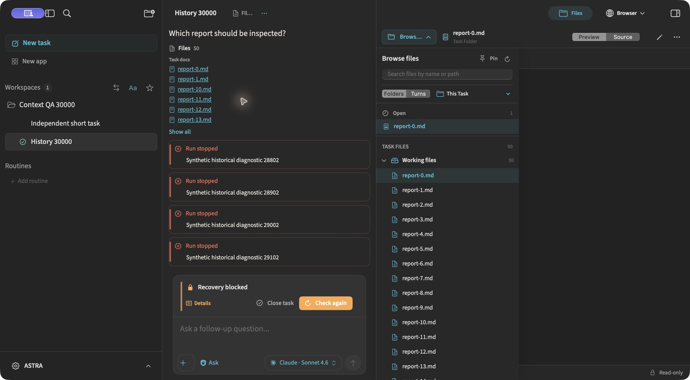
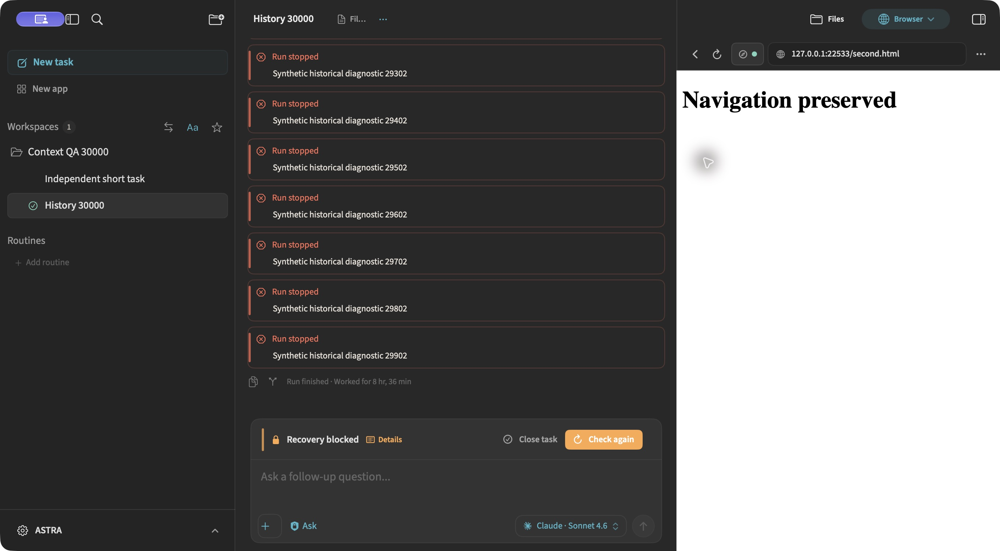

# PR #533: context derivation and Files

## Scope and baseline

Updated the existing branch against main `3e851dfaa5d68d6ec0666675277349e331736830`, including #537 and #551. Context derivation uses a disposable index of the event types it needs, obtained through `TaskHistoryRead` after reconciliation. It never replaces the complete durable history, launch snapshot, execution ownership or native usage evidence. Retry and recovery continue to share the original request's limits.

The independent reviewer found and re-reviewed fixes for:

- Attachment and header file queries that confused imported tasks with the same UUID. Reads and cache publication now check persistent model ownership; header run facts no longer come from the paged transcript.
- Files sessions and document selection keyed only by importable UUID. Persistent task/workspace identity now scopes them. Shared workspace tabs remain shared intentionally; selection belongs to the selected task.
- Queued and already-started document loads that could publish after selection changed. A request captures owner and generation before it is enqueued, and publication validates the generation again after loading.
- Equal-timestamp contract events that could disagree with the verification summary. Both now use deterministic timestamp/UUID ordering.

Browser session/bridge/runtime isolation for imported UUID collisions is a **preexisting issue deferred to the next PR at the owner's explicit request**. This PR only performs ordinary Browser regression QA. It does not claim to isolate Browser sessions with duplicate task UUIDs.

## Reproducible performance measurements

`TaskContextDerivationPerformanceTests` seeds synthetic SQLite histories with 2,610 and 30,000 events. There is one completed run, interleaved user/assistant/error events and tool-result noise, 50 generated Markdown files and a CSV input. No production store was copied or modified.

For each case the same saved database is opened in a fresh context, followed by one cold and twelve warm context refreshes. Times below measure the main-actor **apply** phase, not total app-open latency. The normalized resulting state is compared byte-for-byte against main; only the wall-clock `updatedAt` value is excluded. Both cases matched exactly.

| Events | Main warm median | PR warm median | Reduction | Main / PR cold apply |
|---:|---:|---:|---:|---:|
| 2,610 | 9.35 ms | 5.49 ms | 41% | 16.72 / 11.57 ms |
| 30,000 | 69.55 ms | 43.79 ms | 37% | 80.98 / 59.02 ms |

These are local debug-build samples, not a universal performance guarantee. A previous repetition measured 5.31 and 43.29 ms respectively. The 500/5,000-event main-actor scaling gate also passed, including complete launch history copying.

```sh
RUN_UI_STRESS=1 \
ASTRA_CONTEXT_BENCHMARK_DIR=/private/tmp/astra-pr533-qa/benchmark \
ASTRA_CONTEXT_BENCHMARK_PHASE=adapted \
script/swift_test.sh --no-parallel --filter TaskContextDerivationPerformanceTests
```

## Automated coverage

- Pending inserts/edits, task relinking, deletion/rollback, independent contexts, duplicate task/event UUIDs and pending-turn admission without a new event.
- Preservation of execution ownership/stop proof, remaining request budget and complete launch history.
- Bucketed/unbucketed derivation equivalence and bucket mutation sensitivity; equal-time plan/contract ordering.
- Attachments outside the transcript window; owner-filtered header runs; hosted Files root switching between imported copies.
- Pinned Files sessions, intentionally shared workspace tabs, separate selection, dirty content, duplicate workspace identities and scoped release.
- Deterministic suspension of a preview during an owner switch, plus a queued preview before it starts and A → B → A invalidation.
- Stress suites: Files tree/index/search and transcript windows, including the 100,000-event tier. Seventeen stress tests passed.
- Focused hook mapping checked for new production and regression files. Required hooks remain enabled.

## Native app evidence

Validation uses a separately identified development bundle (`ASTRA Context QA`, `com.coral.ASTRA.contextqa.20261025`) and `~/Library/Application Support/ASTRA Context QA 20261025/AstraDev`. The store is a SQLite backup of the synthetic 30,000-event fixture. Browser test pages are served only at `127.0.0.1:22533`.

Computer Control results in the native app:

| Scenario | Observed result |
|---|---|
| Open the 30,000-event task | Latest transcript slice rendered; original request remained visible; header showed 51 files. |
| Open header and Files | Header listed 50 reports plus `input.csv`; rendered `report-0.md` and the CSV's `synthetic,533` content. |
| Page history with Files open | Loaded the earlier 27,600–28,700 messages while the CSV stayed open. |
| Switch long → independent → long | Independent task had an empty file header; returning restored the long task's CSV selection and 51-file header. |
| Embedded Browser | Local page loaded, link reached “Navigation preserved”, Back and Forward both worked beside the large transcript. |
| Quit and restart ASTRA | The synthetic workspace and tasks reopened; the long task still had its request, paged history and 51-file header. |
| Missing execution proof | The seeded run intentionally has no execution receipt. The app clearly showed “Recovery blocked” before and after restart; the independent task remained usable. No provider execution was requested. |





A read-only audit after the restart still found exactly 30,000 events, one run and two tasks. The long task retained its 50,000-token ceiling and 12,000 tokens used; no new execution was created.

Duplicate-owner and in-flight/queued load races were tested automatically (including hosted SwiftUI), rather than claimed as manually reproduced in the native app.

QA setup correction: the first launch used a `/tmp` App Support override, which ASTRA rejects by design, and therefore opened the normal **development** profile's onboarding. That process was stopped before workspace creation or task execution. A read-only run audit confirmed its newest run still dated October 23. The accepted isolated directory above was then created, and `lsof` verified the actual QA process's store and lease before every native scenario. Production was not opened. The final build script uses the accepted path.

## Validation receipt

- Full `script/swift_test.sh --no-parallel`: **9,461 tests / 945 suites passed**, plus 126 architecture tests, 19 MCP gateway support tests and three Git parser contract tests. Main suite elapsed 898.7 seconds.
- Latest focused corrections: 61 tests / six suites passed. Earlier broad context/history/budget/scaling selection: 84 tests / eight suites passed.
- `RUN_UI_STRESS=1`: 17 tests / three suites passed, including context equivalence, the 5,000-node Files scan/search and 100,000-event transcript tier.
- Isolated development bundle built, signature verified and launched; actual store descriptors were checked after correcting the QA path.
- Independent review and re-review: no actionable findings remaining; the reviewer performed static review separately from the test runner.
- Hook and final-head CI outcomes are recorded in the PR's validation section. No hook bypass or merge was performed.
