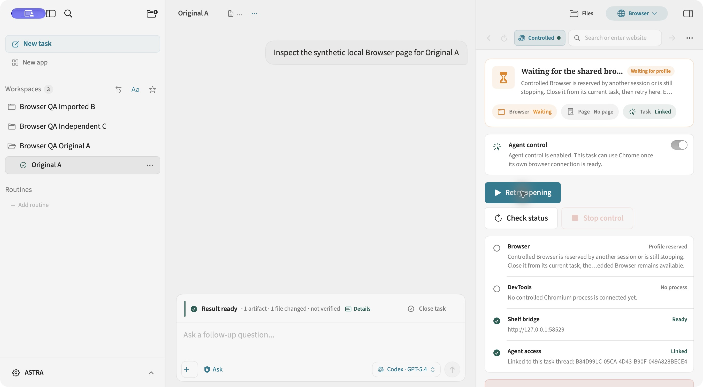
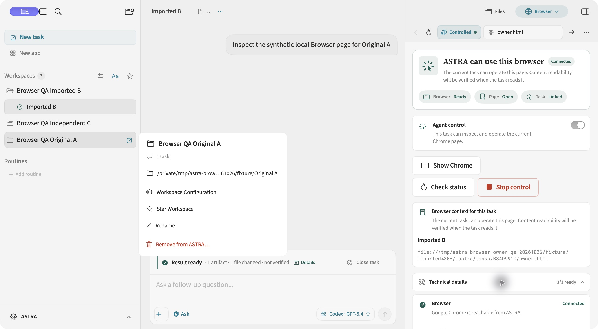

# Browser ownership and shared Chromium reservation

Base: main `8dd383cdbe0fa468fb8259fdc93600917bfca58c`, including merged #533.

## Behavior

Pinned Browser sessions, bridge credentials, policy reads and runtime launch
context now follow the persistent task row. Imported copies with the same UUID
cannot use one another's session. A detached launch snapshot carries its source
owner without changing its durable task context or request budget.

An idle shared shelf can still follow the selected task intentionally. Handoff
revokes the old token and queued requests. An operation already admitted retains
its original session until it drains; it is not rebound to the next task. Stop
revokes queued admission and cancels admitted operations before disconnecting.

The owner's selected policy is **one authenticated Controlled Browser profile,
reserved by one session at a time**. An OS lock and atomic owner/process receipt
protect that profile across windows and app restarts. Reconnection verifies the
exact executable, argv, profile path, PID and process start identity. Multiple
roots, corrupt receipts and unverified launches remain blocked. A timer or CDP
timeout does not release the reservation. Stop retains the lock until the recorded
Chromium root has exited. This is browser-profile ownership, not a replacement
for the runtime/task execution supervisor or proof about arbitrary detached tools.

An existing browser from an older version or an external launch cannot be adopted
without a matching saved process identity. An empty receipt does not become proof
after Retry/restart. Chrome using the profile without a DevTools port also blocks
opening. ASTRA asks the user to close that browser manually and preserves the profile.

## Automated coverage

- Persistent task and workspace UUID collisions; pinned/session deletion isolation.
- Correct capabilities, environment and prompt for source/nested launch snapshots
  across Claude Code, Codex CLI, Antigravity CLI, Copilot CLI, Cursor CLI and OpenCode.
- Policy queries select the persistent owner before applying fetch limits.
- Real localhost HTTP authentication, A→B→A token revocation, queued admission,
  admitted request draining, late callbacks, hidden panels and pin/unpin.
- Stop revokes an authenticated request still waiting for MainActor, cancels
  suspended work, and prevents cancelled work from launching Chrome.
- Real profile locks, independent profile paths, persisted live identity,
  unknown PID, PID reuse, uncertain launch and corrupt receipt behavior.
- Exact argv matching rejects sibling/child profile paths and helper processes;
  configured executables remain supported; ambiguous roots fail closed.
- A stale status refresh cannot release a newer launch's reservation or publish
  older metadata. Explicit opening and direct navigation share the same guard;
  concurrent commands join one launch. The race was reproduced in a failing test
  before the fix after native QA exposed it.
- Reservation has its own runtime stop reason and recovery hint. Waiting is not
  presented as a permission failure, and does not consume or reset the request budget.

## Real app QA

Native Computer Control used the development build with a separate identity:

- App: `ASTRA Browser QA`, bundle `com.coral.ASTRA.browserqa.20261026`.
- Store: `~/Library/Application Support/ASTRA Browser QA 20261026/AstraDev/Stores/g2/default.store`.
- Fixtures: `/private/tmp/astra-browser-owner-qa-20261026/fixture`.
- Three synthetic workspaces: Original A and Imported B share one task UUID;
  Independent C has a different UUID. Each contains a distinct local HTML page.
- No production/development store or browser profile was copied. Ask policy was
  retained. The initial Browser-only phase did not request model-provider execution.

| Scenario | Observed result |
| --- | --- |
| Embedded A→B→A | Separate file paths and DOM values; clicking each page's marker did not change the other page. |
| B owns Controlled; A attempts opening | B retained its Chrome; A displayed the reservation. The original generic failure wording was corrected and retested as “Waiting for the shared browser profile.” |
| Independent C while Controlled reserved | Its Embedded page loaded and its marker changed to `clicked Independent C`. |
| Unexpected app exit | Only the QA app was killed. Chrome PID 91827 survived with parent PID 1. |
| Competitor and Retry after restart | A remained blocked before B reconnected. Process audit found exactly the original Chrome root, PID 91827. |
| Original owner reconnects | B displayed Connected with DevTools PID 91827 and its own page; no replacement process was launched. |
| Stop, then successor | B's Chrome root exited. A then launched exactly one root, PID 22185, with a fresh New Tab. |
| Nonresponding Chrome | QA paused only root 22185 with SIGSTOP. B and Retry remained blocked; process audit found exactly that paused root. It was resumed for cleanup. |

After cleanup, a read-only store audit still contained three tasks and zero runs.
All three retained a 25,000-token budget and zero tokens used.

Screenshots and local logs are retained under
`/private/tmp/astra-browser-owner-qa-20261026/evidence` and `/tmp/astra-browser-owner-*.log`.
The committed screenshots show synthetic content only.

## Review and limitations

The independent agent reviewed and re-reviewed ownership, runtime provenance,
queued requests, Stop, reconnect discovery and user messages. Findings were fixed
with regressions. Review is separate from executed tests and native QA.

Native QA also exposed a preexisting adjacent issue: the conversation view can
retain the other imported copy's transcript when both tasks share a UUID. Browser
correctly changes owner, but transcript/sidebar/history pagination require their
own persistent-owner propagation. That follow-up is outside this Browser PR;
this PR does **not** claim complete imported-task UI isolation.

Six-runtime launch-context coverage is automated. Native Browser QA used WebKit
and Google Chrome. A later final-head smoke at `294d9887` also ran a real Codex
`gpt-6.1-sol` task in a new isolated workspace with Ask and a 25,000-token Hard
Stop. It visibly returned `BROWSER_PIPE_OK`, exited 0, used 19,247 tokens, and
persisted reaped-process, empty-group, stopped-tools and excluded-remote-work
proof before releasing its workspace. A further Chrome open/Stop/status check
created one root and confirmed its exit. The QA app and provider were closed.

An earlier fixture still named unsupported `gpt-5.4`; that run failed with
`model_unavailable`, used zero tokens and retained recovery protection. The
same-UUID fixture also exposed `source_event_missing`, included in the deferred
history/event-identity follow-up. These attempts are not successful provider QA.

The subsequent strict reconnect retest at `f84652ba` also removed only the QA
owner receipt while its known Chrome survived: Retry and a second ASTRA restart
refused to adopt it. After external closure of that identified QA process,
Check status cleared the wait and a fresh open/Stop cycle released the profile.
Queued-request races and corrupt receipt cases remain automated evidence.

## Validation

CI exposed an existing cross-runtime descriptor leak: a concurrent POSIX spawn
could inherit another execution's output writers, preventing EOF certification
after that execution exited. A deterministic regression reproduced the leak in
the provider, utility and host-control launchers. They now close undeclared
descriptors by default, preserve explicit stdin/stdout/stderr and the host-control
supervisor channel, and retain the same strict completion-proof rules. The
regressions use real child processes; they do not relax EOF, stop proof or limits.

Focused CI also exposed worker-pool starvation. A one-worker reproduction and
process samples located synchronous test bridges waiting for their async runner,
and the production POSIX reaper blocking in waitpid/pipe draining. Moving waits
only to a shared Dispatch queue was insufficient: a bounded experiment held 96
waits on an 18-core machine; the utility queue started 90 and could not run a
short operation until release. This explains why a completed child can wait
behind live children that depend on its completion.

The final reapers use one dedicated waiting thread per child, released on
completion. Agent and BinaryRunner share a small executor; Host Control retains
its independent permission boundary and starts its own thread. Synchronous test
APIs run off the Swift cooperative pool. A regression holds 96 waits and requires
a short wait to finish before releasing them, then verifies cleanup. The full
seven-suite process group passes with one cooperative worker. CI repeats that
strict regression without reducing coverage or extending time limits.

Final test, verified-build, hook and CI results are recorded in the pull request.
No hook bypass or merge is performed by the agent.
